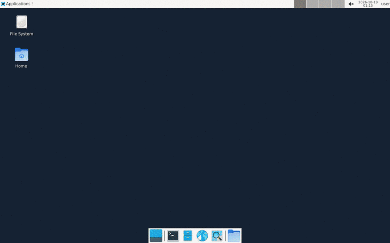

<div align="center">

# 🖥️ Claude Computer Use, in one file

**Give Claude Opus 5.5 a real Linux desktop and watch it work.**
Run the desktop locally with Docker, or in the cloud with [Orgo](https://orgo.ai) with nothing to install.

[Claude computer use docs](https://platform.claude.com/docs/en/agents-and-tools/tool-use/computer-use-tool) ·
[Orgo docs](https://docs.orgo.ai) ·
[Claude Opus 5.5](https://platform.claude.com/docs/en/about-claude/models/overview)



<sub><i>Real run: "find a picture of a real, funny cat and save it to the Desktop", with <code>--fast</code></i></sub>

<sub>Prefer GPT? Same tutorial for GPT-6 Astra: <a href="https://github.com/spencerkinney/gpt-6-astra-computer-use">gpt-6-astra-computer-use</a></sub>

</div>

---

## How it works

```
 ┌────────────┐   task + screenshot    ┌─────────────────────────────┐
 │   cua.py   │ ─────────────────────▶ │  Claude API                 │
 │            │ ◀───────────────────── │  computer_toolset_20260801  │
 └─────┬──────┘ left_click / type / …  └─────────────────────────────┘
       │
       ▼  runs each action with xdotool, sends back screenshots, repeats
 ┌──────────────────────────────┐
 │  Linux desktop               │
 │  🐳 Docker (local)  or       │
 │  ☁️  Orgo (cloud)             │
 └──────────────────────────────┘
```

Claude looks at a screenshot and replies with one or more actions, such as `left_click`, `type`, `scroll`, `key` or `zoom`. `cua.py` runs them in order on the desktop, sends back the results (screenshots for `screenshot` and `zoom`, `OK` for the rest), and repeats until Claude is done. Between actions, Claude's short progress notes print in your terminal as 💭. Everything is in [one small file](cua.py).

### Three ways to run

| Mode | Command | Who runs the loop | Where the desktop runs | Keys needed |
| --- | --- | --- | --- | --- |
| 🐳 **Local** | `python cua.py "task"` | `cua.py` (your code) | Docker on your machine | Anthropic |
| ☁️ **Cloud** | `python cua.py "task" --orgo` | `cua.py` (your code) | Orgo cloud computer | Anthropic + Orgo |
| 🤖 **Orgo agent** | `python cua.py "task" --orgo-agent` | Orgo's [hosted agent](https://docs.orgo.ai/api-reference/chat/completions), running Claude Opus 5.5 | Orgo cloud computer | Orgo only |

Use the first two modes to learn how computer use works and to customize the loop. Use `--orgo-agent` when you just want the task done. It's one API call, and Orgo handles screenshots, actions and retries. It's billed to your Orgo credits.

## Quick start

You need **Python 3.11+**.

**1. Install**

```bash
git clone https://github.com/spencerkinney/opus-5-5-computer-use.git && cd opus-5-5-computer-use
python3 -m venv .venv && source .venv/bin/activate
pip install -r requirements.txt
```

<details>
<summary>On Windows (PowerShell)</summary>

```powershell
git clone https://github.com/spencerkinney/opus-5-5-computer-use.git; cd opus-5-5-computer-use
py -3 -m venv .venv; .venv\Scripts\Activate.ps1
pip install -r requirements.txt
copy .env.example .env
```

Then use `python cua.py ...` exactly as below. Docker Desktop for Windows works for the local desktop.
</details>

**2. Get your API keys**

| Key | Where to get it | Needed for |
| --- | --- | --- |
| `ANTHROPIC_API_KEY` | [platform.claude.com/settings/keys](https://platform.claude.com/settings/keys): click **Create Key**. It starts with `sk-ant-`. | Local and `--orgo` |
| `ORGO_API_KEY` | Sign up at [orgo.ai/start](https://www.orgo.ai/start), then go to [Settings → Credentials](https://www.orgo.ai/settings/credentials). It starts with `sk_live_`. | `--orgo` and `--orgo-agent` |

Your Anthropic account needs billing set up. Each run costs a little, because every turn sends screenshots. Prompt caching is on, so the history Claude re-reads each turn is billed at a fraction of the normal rate.

**3. Put the keys in `.env`**

```bash
cp .env.example .env
```

Open `.env` in any editor and paste your keys after the `=` signs:

```bash
ANTHROPIC_API_KEY=sk-ant-api03-abc123...
ORGO_API_KEY=sk_live_abc123...     # only for --orgo / --orgo-agent
```

`cua.py` loads `.env` automatically. `.env` is in `.gitignore`, so your keys are never committed. Exported shell variables (`export ANTHROPIC_API_KEY=...`) also work.

**4. Pick where the desktop runs**

### Option A: 🐳 Local (Docker)

Needs [Docker Desktop](https://www.docker.com/products/docker-desktop/).

```bash
docker compose up -d --build                # builds and starts the desktop (first build takes ~2 min)
python cua.py "Open Firefox and search for the weather in Tokyo"
```

👀 **Watch it live:** [localhost:6080/vnc.html](http://localhost:6080/vnc.html?autoconnect=1&resize=scale)

Stop the desktop with `docker compose down`.

### Option B: ☁️ Cloud (Orgo), no Docker needed

Make sure `ORGO_API_KEY` is in your `.env` (see step 2). New Orgo accounts get free credit. To use it without a paid plan, also add `ORGO_BILLING_MODE=hourly` to `.env`. Then run:

```bash
python cua.py "Open a terminal and show me the system info" --orgo
```

The script boots a fresh cloud computer, prints a link to watch it live, and deletes the computer when the run ends. Add `--keep` to leave it running.

### Option C: 🤖 Orgo's hosted agent, no Anthropic key needed

Hand the whole loop to Orgo. The task runs on a fresh cloud computer with Claude Opus 5.5, and the agent's progress streams into your terminal:

```bash
python cua.py "Open a terminal and show me the system info" --orgo-agent
```

It uses Orgo's `claude-opus-5.5` model by default. To try Orgo's own computer-use engine on Opus 5.5 instead, set `ORGO_AGENT_MODEL=orgo-agent-opus-5.5` in `.env`.

## Usage

```bash
python cua.py                                   # runs a default demo task
python cua.py "your task here"                  # local Docker desktop
python cua.py "your task here" --orgo           # Orgo cloud computer, our loop
python cua.py "your task here" --orgo-agent     # Orgo cloud computer, Orgo's hosted loop
python cua.py "..." --fast                      # Claude Fast mode: up to 2.5x faster output, billed at 2x
python cua.py "..." --effort high               # think harder per step (low | medium | high | xhigh | max; default medium)
python cua.py "..." --orgo --name my-pc --keep  # name the Orgo computer and keep it afterwards
python cua.py "..." --computer <orgo-id>        # reuse an existing Orgo computer (it's never deleted)
python cua.py "..." --model claude-sonnet-5-5   # any model that supports computer_toolset_20260801
python cua.py "..." --max-steps 50              # allow longer tasks (default 30 turns)
```

Every screenshot is saved to `runs/<timestamp>/` so you can replay what Claude saw.

### Try these

```bash
python cua.py "Using only Firefox (no terminal), find a funny cat picture and save it to the Desktop" --fast
python cua.py "Open Firefox, go to news.ycombinator.com and tell me the top 3 stories"
python cua.py "Open a terminal, write a Python script that prints the first 10 primes, and run it"
python cua.py "Open the file manager and create a folder called hello-world on the desktop"
```

## What's inside

| File | What it is |
| --- | --- |
| [`cua.py`](cua.py) | The agent loop (`run`), `act()` which runs all 17 computer toolset actions with `xdotool`, two tiny backends (`Docker` via `docker exec`; `Orgo` via its [bash endpoint](https://docs.orgo.ai/api-reference/computers/bash)), and `run_orgo_agent` for Orgo's hosted loop |
| [`desktop/Dockerfile`](desktop/Dockerfile) | Debian + XFCE + Firefox + noVNC: a smaller take on Anthropic's reference image |
| [`compose.yaml`](compose.yaml) | Starts the desktop. The viewer is published to `127.0.0.1` only. |

### The Claude computer use API in 30 seconds

```python
response = client.beta.messages.create(
    model="claude-opus-5-5",
    tools=[{"type": "computer_toolset_20260801"}],   # no name, no display size, no beta header
    messages=[{"role": "user", "content": "Save a picture of a cat to my desktop."}],
    ...
)
```

- Claude replies with `tool_use` blocks whose **`name` is the action** (`screenshot`, `left_click`, `type`, `zoom`, …) and whose `toolset_name` is `"computer"`. Often there are several in one turn (a *batch*).
- Run them **in order**. Send back one `tool_result` per call in the next user message, each echoing `"toolset_name": "computer"`.
- Coordinates are in the pixel space of the screenshots you send. Our screenshots are 1280×800 and sent unscaled, so no coordinate maths is needed.
- If one action in a batch fails, skip the rest and mark them `is_error`. Claude sees what happened and replans.

<details>
<summary><b>All 17 actions and how <code>cua.py</code> runs them</b></summary>

| Action | Input | `xdotool` command |
| --- | --- | --- |
| `screenshot` | none | `import -window root png:-` (Docker) or Orgo's screenshot API |
| `zoom` | `region: [x0,y0,x1,y1]` | crop the screenshot with Pillow, scale it up |
| `left_click`, `right_click`, `middle_click` | `coordinate`, optional modifier `text` | `mousemove x y click 1/3/2` |
| `double_click`, `triple_click` | same | `click --repeat 2/3 1` |
| `left_click_drag` | `start_coordinate`, `coordinate` | `mousedown 1 … mouseup 1` |
| `mouse_move` | `coordinate` | `mousemove x y` |
| `left_mouse_down`, `left_mouse_up` | none | `mousedown 1` / `mouseup 1` |
| `cursor_position` | none | `getmouselocation --shell` |
| `scroll` | `scroll_direction`, `scroll_amount`, `coordinate` | `click --repeat n 4/5/6/7` |
| `type` | `text` | `type -- "text"` |
| `key` | `text` (e.g. `ctrl+s`), `repeat` | `key --repeat n ctrl+s` |
| `hold_key` | `text`, `duration` | `keydown … sleep … keyup` |
| `wait` | `duration` | sleep |

</details>

### Inside the desktop image

**TL;DR:** computer use needs four things: a screen, a way to see it, a way to control it, and apps to use. Everything else is optional.

| Component | Job | Needed? |
| --- | --- | --- |
| `Xvfb` | A virtual screen in memory, so no monitor is needed | ✅ Core |
| `imagemagick` (`import`) | Takes the screenshots Claude sees | ✅ Core |
| `xdotool` | Moves the mouse, clicks, types and presses keys | ✅ Core |
| `xfce4` + `dbus-x11` | A lightweight desktop: windows, a dock, a file manager | ✅ Core |
| `x11-utils` (`xdpyinfo`) | Checks the screen is ready before the desktop starts | ✅ Core |
| `firefox-esr` | Something to use | App |
| `x11vnc` + `novnc` + `websockify` | Lets *you* watch the desktop in your browser | Viewer only |

There isn't a separate "computer use server". `cua.py` runs each action with `docker exec claude-desktop xdotool ...` and grabs the screen with `docker exec claude-desktop import -window root png:-`. Orgo computers ship the same `xdotool`, so the cloud backend sends the exact same commands through Orgo's bash endpoint.

<details>
<summary><b>Anthropic's prebuilt reference image</b> (an alternative to <code>desktop/Dockerfile</code>)</summary>

Anthropic publishes a ready-made computer use environment in [anthropic-quickstarts/computer-use-demo](https://github.com/anthropics/anthropic-quickstarts/tree/main/computer-use-demo). It bundles Ubuntu 22.04, Xvfb, the Mutter window manager, the Tint2 panel, `xdotool`, Firefox, LibreOffice and noVNC, plus its own Streamlit chat app and agent loop:

```bash
docker run \
    -e ANTHROPIC_API_KEY=$ANTHROPIC_API_KEY \
    -v $HOME/.anthropic:/home/computeruse/.anthropic \
    -p 5900:5900 \
    -p 8501:8501 \
    -p 6080:6080 \
    -p 8080:8080 \
    -it ghcr.io/anthropics/anthropic-quickstarts:computer-use-demo-latest
```

Then open `http://localhost:8080` for its chat UI and desktop view.

**Why this repo builds its own instead:** the reference image is a full app (several GB, with its own loop and UI), and it needs your API key inside the container. Ours is just the desktop. The loop stays in `cua.py` where you can read it, the key never enters the container, and you get:

- `LANG=C.UTF-8`, so `xdotool` can type accented letters and emoji.
- The dock's browser button opens Firefox directly, and Firefox's welcome tabs are turned off, so Claude starts on a clean screen.
- A 1280×800 screen, well inside Claude's image limits, so screenshots never need resizing.

</details>

## Safety

Computer use acts on whatever is on the screen, so treat page content as untrusted.

- The desktop is **isolated**: it runs in a container or in a throwaway cloud computer, never on your own machine.
- Don't log Claude into accounts you care about, and don't put secrets on the screen.
- If Claude's safety classifiers decline a step, the request falls back to another model automatically (`fallbacks="default"`). If every model declines, the script stops and prints why.
- The local desktop can reach the internet so it can browse.

Read Anthropic's [computer use security considerations](https://platform.claude.com/docs/en/agents-and-tools/tool-use/computer-use-tool#security-considerations) before you point this at anything real.

## Troubleshooting

| Message | Fix |
| --- | --- |
| `Missing ANTHROPIC_API_KEY` | You skipped step 3. Create `.env` from `.env.example` and add your key. |
| `Desktop not running` | Start Docker Desktop, then run `docker compose up -d --build`. |
| `Anthropic API error 401` | The key is wrong or was revoked. Create a new one. |
| `Anthropic API error 400 … does not support tool types` | That model doesn't support `computer_toolset_20260801`. Use `claude-opus-5-5` or `claude-sonnet-5-5`. |
| `Anthropic API error 429` | Rate limited. Wait a moment, or drop `--fast` (Fast mode has its own, lower limit). |
| `Orgo API error` about plan, billing or capacity on `--orgo` | Probably no paid Orgo plan. Add `ORGO_BILLING_MODE=hourly` to `.env` to run on your free credit. |
| `port is already allocated` on `docker compose up` | Another desktop (e.g. the GPT version of this tutorial) is using port 6080. Stop it first. |
| Viewer shows "Disconnected" | Reload the viewer tab. noVNC drops its connection when the container restarts. |

## Using Claude Code or another coding agent?

Point it at [`AGENTS.md`](AGENTS.md). That file has the exact setup commands, where the keys go, and how to verify a run. Claude Code picks it up automatically through `CLAUDE.md`.

## Resources

**Anthropic**
- [Computer use tool](https://platform.claude.com/docs/en/agents-and-tools/tool-use/computer-use-tool): the toolset, all 17 actions, batch actions, screenshot sizing
- [Reference implementation](https://github.com/anthropics/anthropic-quickstarts/tree/main/computer-use-demo): Anthropic's full Docker demo
- [Models overview](https://platform.claude.com/docs/en/about-claude/models/overview) · [Fast mode](https://platform.claude.com/docs/en/build-with-claude/fast-mode) · [Prompt caching](https://platform.claude.com/docs/en/build-with-claude/prompt-caching)
- [Python SDK](https://github.com/anthropics/anthropic-sdk-python)
- [API keys](https://platform.claude.com/settings/keys) · [Pricing](https://platform.claude.com/docs/en/about-claude/pricing)

**Orgo**
- [Orgo docs](https://docs.orgo.ai) · [Quickstart](https://docs.orgo.ai/quickstart)
- [Claude Computer Use on Orgo](https://docs.orgo.ai/guides/claude-computer-use)
- [Orgo hosted agent (chat completions)](https://docs.orgo.ai/api-reference/chat/completions)
- [API reference](https://docs.orgo.ai/api-reference/introduction)
- [Get an API key](https://www.orgo.ai/start) · [Pricing](https://orgo.ai/pricing)

## License

[MIT](LICENSE)
